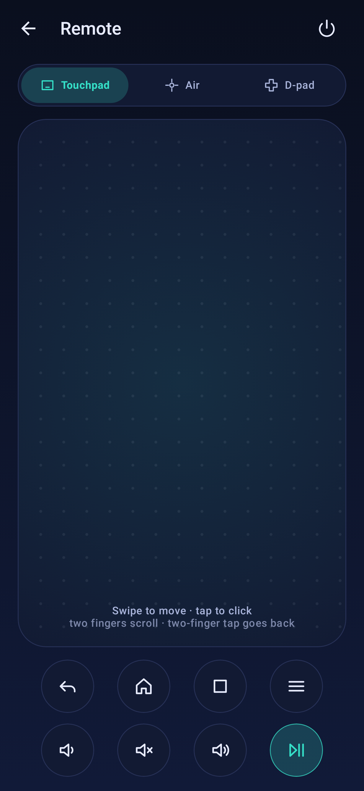
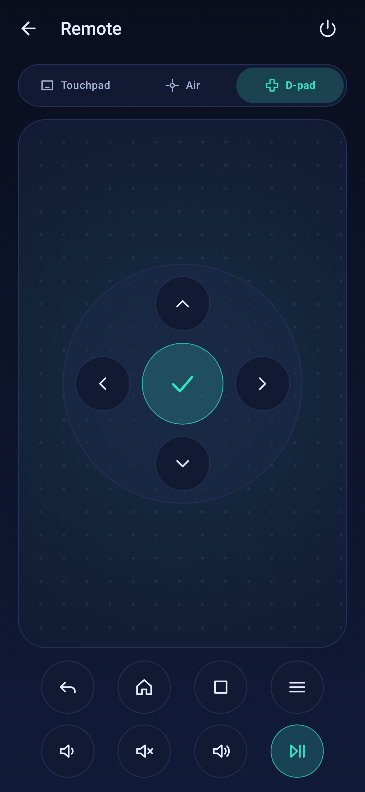
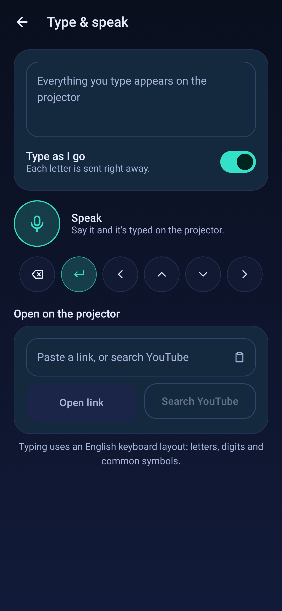
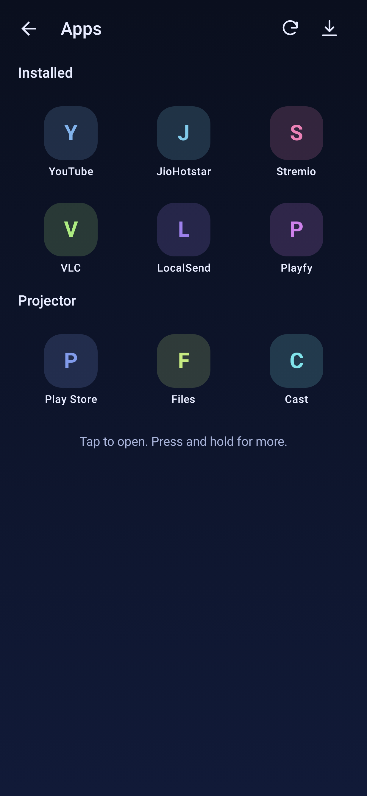

# ProjectorConnect

Your phone as the remote for an Android projector or TV box, over Wi-Fi and with no computer. ProjectorConnect works as a
**mouse, keyboard and remote** (Android shows its normal pointer on the projector's screen), opens links and apps, installs
APK files, shows the projector's memory and power controls, and also contains **Auto keystone**: it straightens the picture
of Hisilicon-based projectors (Newlink / Zhiying firmware on a Hi3751 board, the "HY300-style" units) using the phone camera.

<p align="center">
  
  
  
  
  
</p>

## What it does

| | |
|---|---|
| **Remote** | *Touchpad*: swipe to move the pointer, tap to click, two fingers to scroll, two-finger tap for Back, press and hold to drag. *Air*: point the phone like a Magic Remote (gyroscope), hold the big button to aim and tap to click. *D-pad*: arrows and OK. Back, Home, recent apps, menu, volume, mute and play/pause are always there. |
| **Type & speak** | Everything you type appears on the projector as you type it (or send it in one go). Tap the mic to dictate. Arrow keys, Enter and Backspace sit underneath. Paste a link to open it, or search YouTube. |
| **Apps** | See what is installed, open an app, stop it or uninstall it. |
| **Install app** | Pick an APK (or an .apkm / .apks / .xapk bundle) on the phone; it is sent over ADB and installed. Failures are explained ("built for 64-bit, the projector is 32-bit"). |
| **Share to open** | Share a YouTube or web link from any app to ProjectorConnect and it opens on the projector. |
| **Projector** | Memory and storage, screen off / wake, free up memory, restart, shortcuts to the projector's Wi-Fi and display settings, and the firmware Auto-keystone switch. |
| **Auto keystone** | The camera-based correction described below. |

## Why Auto keystone

These projectors advertise an *auto keystone* feature but ship without the camera or tilt sensor it needs (Android reports
no camera and no sensors), so "Auto" just resets the keystone and leaves a trapezium. The projector does have a working
four-corner keystone engine, and the phone has everything the projector is missing: a camera, a gravity sensor and a
calibrated lens. Auto keystone connects the two.

## How to use

Steps 1-2 are the same for everything; the rest is the Auto keystone flow (the other features are one tap from Home).

1. **Prepare the projector.** Switch it on, put it on the same Wi-Fi as the phone and enable network debugging (ADB over
   the network, port 5555).
2. **Open ProjectorConnect and tap *Find my projector*.** It scans your Wi-Fi, recognises a supported projector and connects. The
   next time it reconnects by itself. (You can also type an IP address.)
3. **Follow the guide** (three short pages: dim the room, where to stand, how to hold the phone) and tap *I'm ready*.
4. **Take the photos.** The projector shows a test pattern. A live camera view tells you when all four circles are in
   view, the phone is level and it is held still; then it takes the photo by itself (or tap the shutter). Four photos by
   default.
5. **The app solves and applies** the keystone and shows the pattern again.
6. **Say whether it looks right.**
   * *Looks correct* → optionally take one photo of the result, and the app learns what "right" means for your room.
   * *Not quite* → say what is off (right edge short, slopes up to the left, too wide...). The app adjusts, applies and
     asks again. Undo restores the previous keystone at any time.

The very first time it meets a projector it saves that projector's original keystone, so you can always go back
(*Settings → Restore the original keystone*).

## How it works

* **The projector's keystone is a four-corner warp.** The app reads and sets the corner offsets through the projector's own
  Hisilicon TV service, using a tiny helper (`ksall.jar`) it pushes over ADB. The corner values are pixels pulled in from
  each corner of the 1280x720 panel.
* **Measurement.** A small app (`pattern.apk`, also pushed over ADB) draws four white circles. The phone photographs
  them. The circles are found with a morphological opening (it removes grid lines and borders, keeping only filled
  discs) and the four most similar, convex blobs are chosen.
* **Removing the phone's own perspective.** The gravity sensor tells which way is up in the camera frame and Camera2
  reports the lens intrinsics, so the photo is turned into the view of a level camera with a pure rotation, which is exact
  for any plane. If the phone faces the wall, rectangles on the wall are rectangles in that view.
* **Solving.** Four circles give the panel-to-view mapping exactly. The app picks the largest rectangle of the target
  shape whose pre-image still fits the panel (corner pull-in is capped), and computes the corner offsets that produce it.
  Several photos are solved independently and averaged after rejecting gross outliers.
* **Applying.** The projector's setters are *relative* steps, so the app reads the current values, sends the differences
  and verifies by reading back.
* **Learning.** An accepted picture is treated as ground truth: the app fits the aspect ratio, the assumed camera angle
  and a roll-sensor bias that would have produced it, and blends them into a profile (stored on the phone). A rejection
  nudges the parameter behind the complaint in whichever direction improves the predicted picture, with a smaller step
  each time you reverse.

## How the remote works

The projector ships Android's own `uinput` tool and lets the ADB shell user create virtual input devices. ProjectorConnect
starts one `uinput -` process over the ADB connection and streams JSON to it: a virtual **mouse** (relative movement, wheel,
buttons), a virtual **keyboard** and the remote keys (Home, Back, volume, media, D-pad). Android sees real hardware, so it draws
its normal pointer and every app (YouTube, Netflix...) behaves as with a mouse. Nothing is installed on the projector and the
devices disappear when you leave the remote (about 45 seconds later) or disconnect. Pointer movement is merged and sent about
80 times a second. The air mouse works out which way is up from the gravity sensor, so it works whether the phone is held flat
like a TV remote or upright.

## Privacy and safety

* Photos are analysed on the phone, kept only until analysed and never uploaded. APK files go straight from the phone to the projector.
* The ADB key pair and all learned data live in the app's private storage.
* Only English letters, digits and common symbols can be typed (US keyboard layout).
* Every value is range-checked before it is sent; results that look wrong (tiny area, non-convex) are refused.
* ADB over the network has no password on this firmware. Turn network debugging off when you are done if you can.

## Compatibility

Auto keystone only works on projectors with the Hisilicon TV API (`/system/framework/HitvShare.jar`, `HitvManager.jar` and the
`hitvservice` service), e.g. Newlink/Zhiying units on a Hi3751 board. The app checks and says so for anything else.
The remote, keyboard, apps and install features need any Android projector or TV box with ADB over the network (the virtual input uses the stock `uinput` tool, present on Android 8+). Auto keystone needs the Hisilicon API above. The phone needs Android 8+; Auto keystone also needs a back camera and a gravity sensor, and the air mouse needs a gyroscope. Phones that report camera calibration
(most recent ones) are the most accurate; others fall back to focal length and sensor size.

## Building

```bash
./tools/build-assets.sh        # only when projector/ or pattern/ change (rebuilds the two projector-side files)
./gradlew assembleRelease      # app/build/outputs/apk/release/ (debug-signed, installs over any build)
./gradlew assembleDebug        # app/build/outputs/apk/debug/app-debug.apk
./gradlew testDebugUnitTest    # all JVM tests, including UI snapshots
```

Requires JDK 17 and the Android SDK (platform 34, build-tools 34.0.0); put `sdk.dir=...` in `local.properties`.

### Tests

* Remote input (the exact JSON `uinput` accepts, the typing map), app listing, status parsing and the install flow (single APK and split bundles) are tested against a recording shell. `KS_PROJECTOR=<ip>` also runs `LiveToolsTest`, which lists the real projector's apps and checks the virtual mouse and keyboard appear and disappear.
* Pure logic (geometry, solver, pose with a simulated camera, detector on rendered photos, learning on a simulated wall)
  runs as ordinary JVM tests.
* The ADB layer is tested against a simulated projector. With `KS_PROJECTOR=<ip>` it also runs read-only against a real one,
  and `KS_SCAN=<ip>/<prefix>` tests the subnet scan.
* `KS_CAPTURES=<dir>` cross-checks the pipeline against real photos (never committed: they show a room).
* **UI snapshot tests** render every screen with Robolectric and write PNGs to `app/build/ui-snapshots/`, so the UI can be
  reviewed without a device. The live camera itself cannot be rendered this way and has to be tested on a phone.

## Project layout

See [CLAUDE.md](CLAUDE.md) for the code map, the projector facts and the conventions used in this repository.

## Known limitations

* The air mouse and touchpad feel could only be checked in code, not on hardware: tune the speeds in Settings → Remote.
* Non-English text cannot be typed (the projector only gets key presses); dictation works for languages written with an English keyboard layout.
* App names are guessed from package names for apps the app doesn't know.

* The phone is assumed to face the wall (small deviations are absorbed by averaging and by what the app learns).
* Only one picture shape per profile is learned; moving the projector or your seat may need a new run.
* Android 17+ may ask for a "local network" permission; if scanning finds nothing on such a phone, grant it in app settings.
